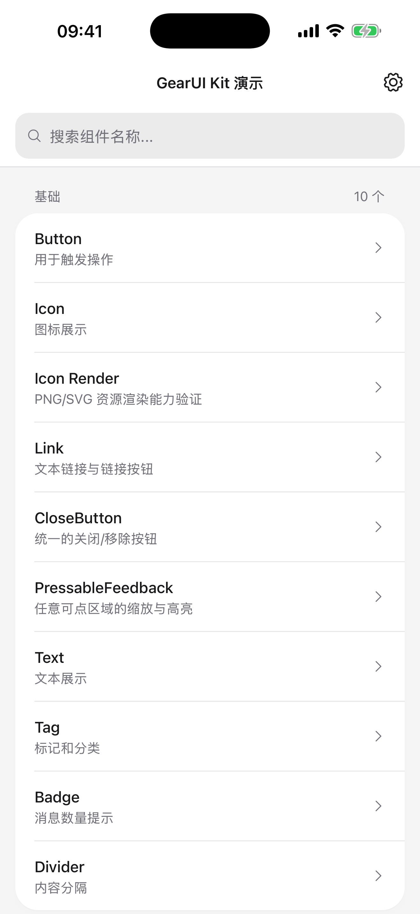
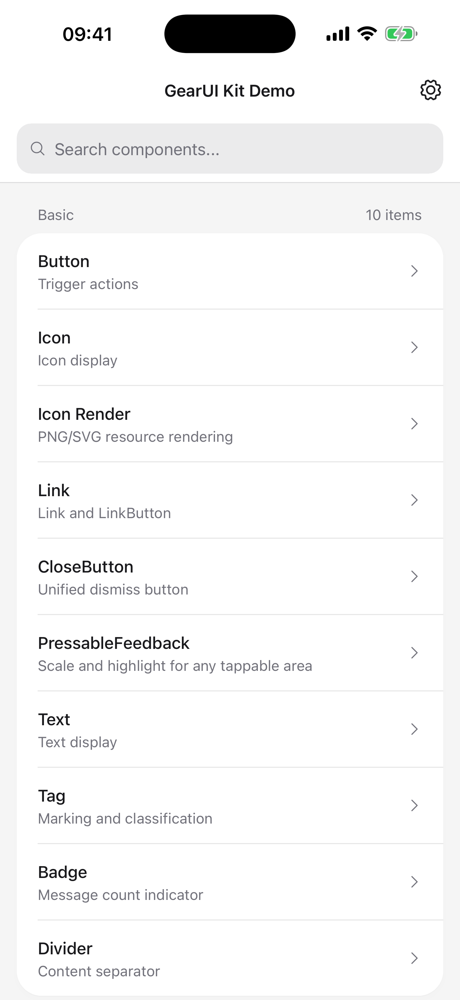
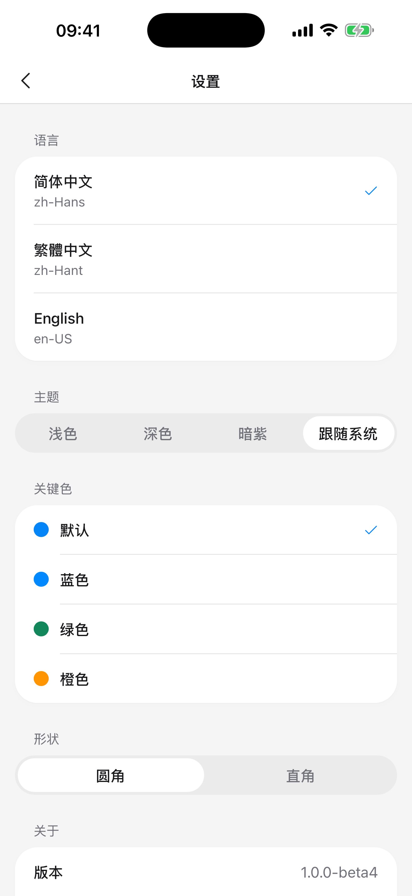
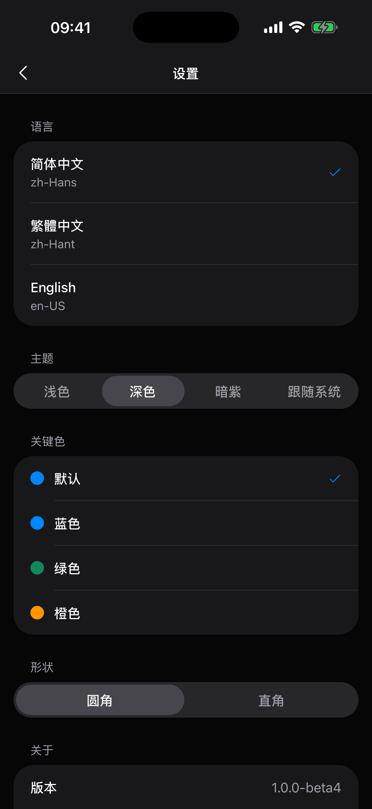

# GearUI Kit

[English](./README.md) | [简体中文](./README.zh-Hans.md)

Build beautiful, iOS-inspired UI across iOS, Android, Web, and HarmonyOS with GearUI Kit, a Kotlin Multiplatform (KMP) UI framework.

## Release Information

- Coordinates: `com.gearui:gearui-kit:1.0.0`
- Available on Maven Central; `1.0.0-beta1` was the first public release (2026-08-15)
- Published artifacts: Android, iOS (arm64 / simulator arm64 / x64), JS (browser)
- Also builds for HarmonyOS (`ohosArm64`) through a separate configuration; not published to Maven Central
- Website: [https://gearui.com](https://gearui.com)
- License: Apache License 2.0

## Author Information

- Author: `zoujiaqing`
- Email: `zoujiaqing@gmail.com`

## Screenshots

Captured from the sample app on an iPhone 17 Pro Max simulator (iOS 26.2).

| Home (Chinese) | Home (English) | Settings (Light) | Settings (Dark) |
| --- | --- | --- | --- |
|  |  |  |  |

Language and theme are switched at runtime from the settings page; every
component follows both without any per-screen wiring.

## Components

<!-- component-index:begin -->
**90 components** in 6 categories. Every one of them ships a demo page in the sample app.

| Category | Components |
| --- | --- |
| Basic (12) | `Button`, `ButtonGroup`, `FabMenu`, `Icon`, `Link`, `SuggestionChips`, `CloseButton`, `PressableFeedback`, `Text`, `Tag`, `Badge`, `Divider` |
| Form (23) | `Input`, `Checkbox`, `AgreementCheckbox`, `Radio`, `InputOTP`, `ComboBox`, `NumberField`, `ToggleButton`, `InputGroup`, `Switch`, `Slider`, `Stepper`, `Textarea`, `Rate`, `Select`, `Picker`, `DatePicker`, `Upload`, `Form`, `Cascader`, `ListBox`, `Questionnaire`, `ColorPicker` |
| Navigation (8) | `NavBar`, `BottomNavBar`, `Tabs`, `Drawer`, `Steps`, `IndexBar`, `Segmented`, `Toolbar` |
| Data display (25) | `List`, `Card`, `Cell`, `CellGroup`, `Table`, `Image`, `ImageViewer`, `Avatar`, `ScrollShadow`, `Collapse`, `Progress`, `Empty`, `Skeleton`, `Timeline`, `Calendar`, `Format`, `Watermark`, `Meter`, `User`, `Code`, `CodeBlock`, `Reasoning`, `ToolCallCard`, `AgentTrace`, `Kbd` |
| Feedback (15) | `SwipeCell`, `ActionSheet`, `Toast`, `Dialog`, `Tooltip`, `ContextMenu`, `Loading`, `Alert`, `NoticeBar`, `Notification`, `Snackbar`, `Popup`, `Popover`, `Result`, `Tour` |
| Layout (7) | `Grid`, `Swiper`, `SearchBar`, `PullRefresh`, `LoadMore`, `BottomSheet`, `BackTop` |

<details>
<summary>What each component does</summary>

**Basic**

| Component | Purpose |
| --- | --- |
| `Button` | Trigger actions |
| `ButtonGroup` | Connected buttons and split button |
| `FabMenu` | A floating button that opens actions |
| `Icon` | Icon display |
| `Link` | Link and LinkButton |
| `SuggestionChips` | Quick replies and suggested questions |
| `CloseButton` | Unified dismiss button |
| `PressableFeedback` | Scale and highlight for any tappable area |
| `Text` | Text display |
| `Tag` | Marking and classification |
| `Badge` | Message count indicator |
| `Divider` | Content separator |

**Form**

| Component | Purpose |
| --- | --- |
| `Input` | Text input |
| `Checkbox` | Multiple selection |
| `AgreementCheckbox` | Terms and privacy consent |
| `Radio` | Single selection |
| `InputOTP` | One-time code input |
| `ComboBox` | Filterable suggestions |
| `NumberField` | Typed and stepped number |
| `ToggleButton` | Toggle and button group |
| `InputGroup` | Field with attached blocks |
| `Switch` | Toggle switch |
| `Slider` | Value selection |
| `Stepper` | Number stepper |
| `Textarea` | Multiline text input |
| `Rate` | Rating |
| `Select` | Dropdown selector |
| `Picker` | Multi-column picker |
| `DatePicker` | Date & time picker |
| `Upload` | File upload |
| `Form` | Form container |
| `Cascader` | Cascade selector |
| `ListBox` | Single or multiple choice shown in the page |
| `Questionnaire` | Step-by-step questions: choices, free text, agent prompts |
| `ColorPicker` | Swatches, color plane and hex entry |

**Navigation**

| Component | Purpose |
| --- | --- |
| `NavBar` | Page navigation bar |
| `BottomNavBar` | App bottom navigation |
| `Tabs` | Content switching |
| `Drawer` | Slide drawer |
| `Steps` | Step indicator |
| `IndexBar` | Alphabet index |
| `Segmented` | Segmented control |
| `Toolbar` | Related actions that wrap on narrow screens |

**Data display**

| Component | Purpose |
| --- | --- |
| `List` | List display |
| `Card` | Card container |
| `Cell` | List cell component |
| `CellGroup` | Grouped list rows |
| `Table` | Data table |
| `Image` | Image display |
| `ImageViewer` | Image preview |
| `Avatar` | User avatar |
| `ScrollShadow` | Fades scrollable edges |
| `Collapse` | Content collapse |
| `Progress` | Progress display |
| `Empty` | Empty state |
| `Skeleton` | Loading placeholder |
| `Timeline` | Timeline display |
| `Calendar` | Calendar display |
| `Format` | Compact numbers, relative time, lunar |
| `Watermark` | Page watermark |
| `Meter` | A measurement within known bounds |
| `User` | Avatar, name and description |
| `Code` | Inline code and copyable snippets |
| `CodeBlock` | Line numbers, copy, diff, long-code cut |
| `Reasoning` | Model reasoning that closes when done |
| `ToolCallCard` | One tool call: input and output |
| `AgentTrace` | An agent run, step by step |
| `Kbd` | Web and external-keyboard shortcut hint |

**Feedback**

| Component | Purpose |
| --- | --- |
| `SwipeCell` | Swipeable cell |
| `ActionSheet` | Bottom action sheet |
| `Toast` | Message toast |
| `Dialog` | Modal dialog |
| `Tooltip` | Tooltip |
| `ContextMenu` | Context menu |
| `Loading` | Loading state |
| `Alert` | Inline status message |
| `NoticeBar` | Scrolling announcement |
| `Notification` | Global notification |
| `Snackbar` | Bottom message |
| `Popup` | Popup content |
| `Popover` | Popover tooltip |
| `Result` | Operation result |
| `Tour` | Feature guide |

**Layout**

| Component | Purpose |
| --- | --- |
| `Grid` | Grid layout |
| `Swiper` | Content carousel |
| `SearchBar` | Search input |
| `PullRefresh` | Pull to refresh a list |
| `LoadMore` | Load the next page of a list |
| `BottomSheet` | Bottom sheet |
| `BackTop` | Back to top |

</details>
<!-- component-index:end -->

The table above is generated from `sample/.../config/ComponentConfig.kt` by
`scripts/gen_component_index.py`; a CI check fails when it goes stale.

## Quick Integration

### 1. Published Dependency (Recommended)

Released on Maven Central. Declare the single root coordinate — Gradle reads the
module metadata and resolves the per-target artifact (`-android`, `-js`,
`-iosarm64`, …) for whatever you are compiling. Never depend on those directly.

GearUI Kit depends on KuiklyUI, and KuiklyUI 2.x is published to Tencent's Maven
mirror rather than Maven Central, so add that repository too — without it the
dependency does not resolve.

```kotlin
repositories {
    mavenCentral()
    maven("https://mirrors.tencent.com/nexus/repository/maven-tencent/")  // KuiklyUI 2.x
}

kotlin {
    sourceSets {
        commonMain.dependencies {
            implementation("com.gearui:gearui-kit:1.0.0")
        }
    }
}
```

### 2. Local Development Dependency (`mavenLocal`)

First publish from the `gearui-kit` project to your local Maven repository:

```bash
./gradlew :gearui-kit:publishToMavenLocal
```

Then add it in your app project:

```kotlin
repositories {
    mavenLocal()
    mavenCentral()
    maven("https://mirrors.tencent.com/nexus/repository/maven-tencent/")  // KuiklyUI 2.x
}

kotlin {
    sourceSets {
        commonMain.dependencies {
            implementation("com.gearui:gearui-kit:1.0.0")
        }
    }
}
```

### 3. In-Repo Module Dependency (During Development)

```kotlin
dependencies {
    implementation(project(":gearui-kit"))
}
```

## Basic Usage

```kotlin
@Page("MainPage")
class MainPage : View() {
    @Composable
    // View mounts the App root (theme, i18n, overlays, safe area) for you.
    // Override themeMode() / themeSpec() to change it; do not call App() here.
    override fun Content() {
        MainPageContent()
    }
}

@Composable
private fun MainPageContent() {
    val colors = Theme.colors

    Column(
        modifier = Modifier
            .fillMaxSize()
            .background(colors.background)
            .padding(16.dp)
    ) {
        Button(
            text = I18n.strings.buttonConfirm,
            theme = ButtonTheme.PRIMARY,
            onClick = {}
        )
    }
}
```

### Android host: render thread stack

Kuikly runs composition, measure and layout on its own context thread, created with
the platform default stack (about 1 MB). Placement recurses once per layout level, so
deep screens can overflow it — debuggable builds first, since ART runs them without
optimisations. Give the thread the main thread's 8 MB before the first page opens:

```kotlin
KuiklyRenderAdapterManager.krThreadAdapter = object : IKRThreadAdapter {
    private val executor = Executors.newCachedThreadPool()
    override fun executeOnSubThread(task: () -> Unit) = executor.execute(task)
    override fun stackSize(): Long = 8L * 1024 * 1024
}
```

The sample does this in `SampleThreadAdapter`.

## Supported Platforms

| Platform | Minimum | Verified at | Not accepted yet |
| --- | --- | --- | --- |
| Android | minSdk 21 (compileSdk 36) | Interaction on a device (Xiaomi 12 Pro, Android 16); unit tests and lint in CI | A low-end device's performance |
| iOS | 15.0 | Interaction on the simulator (iOS 18.2 and 27.0); Kotlin tests on the simulator in CI | A physical-device pass of the kit itself |
| Web (H5) | Chromium-based browsers | Every sample page loads, scrolls and resizes in both themes (Playwright, Chromium) | Keyboard operation and focus order; Safari/WebKit |
| HarmonyOS | — | Builds end to end (kit, NAPI glue, HAP) | Running on a device or emulator |

Toolchain: Kotlin **2.1.21** (must equal KuiklyUI's), KuiklyUI **2.30.0**, Compose Multiplatform **1.7.3**.

**Limited support — stated the same everywhere:**

- **Right-to-left languages are not supported.** KuiklyUI does not pass the layout direction through.
- **iOS Dynamic Type is not followed.** KuiklyUI turns font scaling off on iOS; Android's font scale is followed.
- **HarmonyOS is build-level only.** Nothing about its UI is verified until it runs on a device.
- **Blur is off by default** until four renderer gaps are fixed upstream (see `docs/VISUAL_SPEC.md` §5).
- The Android system keyboard follows the system's light or dark setting, not the app's — the platform offers no way to set it.

**Touch targets are 44 × 44 on every platform.** This follows Apple's rule and is a deliberate
choice: Android's guideline is 48 dp. Controls never overlap their neighbours' targets.

HarmonyOS is supported and builds end to end — Kotlin/Native → CMake NAPI glue
→ ArkTS → an installable HAP carrying both `libshared.so` and
`libkuikly_entry.so`. It cannot be a target of the normal build: the KuiklyUI
artifacts carrying `ohosArm64` are published against Kotlin `2.0.21-KBA-010`, so
ohos uses a parallel build configuration selected with
`-c settings.ohos.gradle.kts`:

```bash
./gradlew -c settings.ohos.gradle.kts :sample:linkSharedDebugSharedOhosArm64
```

The HAP has **not been launched on a device or emulator yet**, so nothing about
the UI is verified there — installing needs an emulator image and a signed
package, both behind a Huawei developer account. See
[sample/ohosApp/README.md](./sample/ohosApp/README.md) for the build steps and
exactly what remains.

## Project Notes

- Component layer path: `gearui-kit/src/commonMain/kotlin/com/gearui/components`
- Sample project: `sample/`

## Component Convergence Strategy

- For navigation, only the core entry is kept: `Tabs` (content switching).
- Accordion mode is unified into: `Collapse.Accordion` (no standalone `Accordion` component maintained).
- No synonymous wrapper components are kept, to avoid duplicate APIs and duplicate sample pages.

## Documentation Entry

- Architecture overview: [ARCHITECTURE.md](./ARCHITECTURE.md)
- Documentation entry: [docs/ARCHITECTURE.md](./docs/ARCHITECTURE.md) — design system,
  i18n, visual spec, component spec, coverage and quality status
- Web host: [sample/jsApp/README.md](./sample/jsApp/README.md)
- HarmonyOS host: [sample/ohosApp/README.md](./sample/ohosApp/README.md)

Documentation is written in English first; `*.zh-Hans.md` files are the Chinese
counterparts. Code comments are English only — enforced by
`scripts/ci/check_english_comments.sh` (see
[docs/COMPONENT_SPEC.md](./docs/COMPONENT_SPEC.md) §8).

## Development Commands

```bash
# Build the library per platform
./gradlew :gearui-kit:compileDebugKotlinAndroid
./gradlew :gearui-kit:compileKotlinIosSimulatorArm64
./gradlew :gearui-kit:compileKotlinJs

# Run the sample
./gradlew :sample:installDebug                    # Android
./gradlew :sample:jsApp:jsBrowserDevelopmentRun   # Web, then open http://localhost:8081/

# HarmonyOS uses a parallel build configuration (unbuilt — see sample/ohosApp/README.md)
./gradlew -c settings.ohos.gradle.kts :sample:linkSharedDebugSharedOhosArm64

# Architecture guardrails — 20 checks, all runnable locally
for f in scripts/ci/check_*.sh; do "$f"; done
```

## License

Apache License 2.0 — see [LICENSE](./LICENSE) and [NOTICE](./NOTICE).

Copyright 2026 Shanghai Boyu Information Technology Co., Ltd.
Developed by zoujiaqing (<zoujiaqing@gmail.com>) · [netonstream.com](https://netonstream.com)
